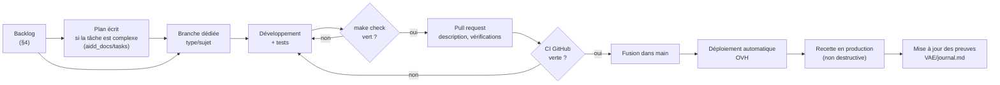

# Gestion de projet — DevDoc

DevDoc est un projet personnel mené seul, du 2025-06-05 à aujourd'hui (2026-10-12). Ce document décrit comment le travail est organisé, planifié, priorisé et suivi. Il s'appuie sur des traces vérifiables : historique Git, pull requests GitHub, plans de tâches et CI.

## 1. Chronologie et phases

D'après `git log origin/main` (156 commits hors fusions, 48 pull requests) :

| Période | Commits | Phase | Livrables marquants |
|---|---|---|---|
| 2025-06 → 2025-11 | 39 | Démarrage : modèle de contenu, SPA, QCM | 3 PR proposées par l'agent Codex et fusionnées (#1 à #3, août 2025) |
| 2025-12 → 2026-01 | 65 | Développement intensif et mise en ligne | Branche `deploy` fusionnée dans `main` à chaque livraison (PR #4 à #23) |
| 2026-05 → 2026-08 | 9 | Industrialisation | Pipeline CI/CD GitHub Actions et déploiement automatique depuis `main` (PR #25 à #29) |
| 2026-09 | 19 | Agents IA et nettoyage | API d'administration pour les agents de cours (PR #30), suppression d'une page obsolète (#31), Vite seul pipeline d'assets (#32) — chacun précédé d'un plan écrit |
| 2026-10 | 24 | Qualité, sécurité, documentation | Boucle `make check`, harness agents, correction de failles (#37, #39), PWA (#41), schéma BDD (#44), tests front (#46, #47), dossier VAE |

Les mois les plus chargés correspondent à des périodes de disponibilité. Le projet n'a pas de calendrier imposé.

## 2. Méthode de travail

Le projet suit une démarche **itérative et incrémentale** (inspirée de Kanban) : une tâche à la fois, livrée par petites PR, sans sprint fixe. C'est adapté à un développeur seul dont la disponibilité varie.

| Pratique | Mise en œuvre | Depuis | Preuve |
|---|---|---|---|
| Une branche par tâche, nommée `type/sujet` | `fix/secure-admin-and-api`, `docs/bdd-schema`, `test/front-vitest`… | 2026-08 (avant : `deploy`, `main2`) | Liste des PR |
| Messages de commit normalisés | Conventional Commits (`feat`, `fix`, `docs`, `test`, `refactor`…) | 2026-07 : 47 des 51 commits depuis cette date, contre 1 sur 105 avant | `git log` |
| Plan avant le code pour les tâches complexes | Framework AIDD : objectif, phases, décisions justifiées, puis revue | 2026-08-31 | [`aidd_docs/tasks/`](../aidd_docs/tasks/README.md) |
| Définition du « terminé » | `make check` vert (lint, PHPStan, PHPUnit, Vitest, build), CI verte, documentation des preuves mise à jour | 2026-10-12 | `Makefile`, `AGENTS.md`, hook de fin de tâche `.agents/hooks/` |
| Revue de code | Revue outillée par agent (code, fonctionnel, pertinence) pour les gros changements ; PR décrites avec leurs vérifications | 2026-09-01 | `aidd_docs/tasks/2026_09/…/review.md` |
| Intégration et livraison continues | Toute PR passe la CI ; tout push sur `main` est déployé | 2026-07-13 | `.github/workflows/ci.yml`, [`CI_CD.md`](CI_CD.md) |
| Suivi des anomalies | Identifiant, gravité, détection, statut | 2026-10-12 | [`tests/plan-de-tests.md` §7](tests/plan-de-tests.md) |

## 3. Outils

| Besoin | Outil |
|---|---|
| Gestion de versions et revue | Git, GitHub (pull requests) |
| Intégration et déploiement continus | GitHub Actions → hébergement OVH (rsync sur SSH) |
| Environnement reproductible | Docker Compose, `Makefile` |
| Planification des tâches complexes | Plans AIDD en Markdown (`aidd_docs/tasks/`) |
| Assistance au développement | Agents IA (Claude Code, Codex) encadrés par des consignes, des permissions et des hooks communs ([`harness-agents.md`](harness-agents.md)) |
| Conception | Figma (maquettes), Mermaid (diagrammes versionnés avec le code) |
| Suivi des preuves et des décisions | [`VAE/journal.md`](../VAE/journal.md), [`VAE/preuves.md`](../VAE/preuves.md) |

## 4. Backlog priorisé (au 2026-10-12)

**Critères de priorité**, dans l'ordre :
1. sécurité et intégrité des données ;
2. fonctionnement pour l'utilisateur ;
3. fiabilité de la chaîne qualité ;
4. dette technique et évolutions.

À priorité égale, la tâche la moins coûteuse passe en premier.

| Priorité | Tâche | Origine | Effort |
|---|---|---|---|
| P1 | Exécuter la migration `Version20261012124537` en production, puis `doctrine:schema:validate` | [`base-de-donnees.md` §5](conception/base-de-donnees.md) | S |
| P1 | Protéger la branche `main` : checks CI obligatoires avant fusion (recommandé dans `CI_CD.md`, non appliqué : l'API GitHub répond « Branch not protected ») | Constat du 2026-10-12 | S |
| P1 | Traiter les dépendances vulnérables (34 alertes Composer, 12 npm) | Audits CI, [`preuves.md`](../VAE/preuves.md) | M |
| P1 | Revoir les 4 constats critiques de la revue du 2026-09-01 (génération de cours IA) : leur traitement n'est pas tracé | [`aidd_docs/tasks/`](../aidd_docs/tasks/README.md) | M |
| P2 | AN-04 : `/api/qcm/language/*` renvoie 500 | Plan de tests | S |
| P2 | AN-05 : appels 401 pour un visiteur non connecté | Plan de tests | S |
| P2 | Fonctions hors ligne jamais appelées (stores IndexedDB vides) | [`base-de-donnees.md` §6](conception/base-de-donnees.md) | S |
| P3 | Rendre PHPStan bloquant et ajouter ESLint à la CI | Plan de tests §8 | S |
| P3 | Tests de bout en bout (Playwright) sur les parcours principaux | Plan de tests §8 | M |
| P3 | Tester `HtmlSanitizerService` et augmenter la couverture (7,5 %) | Plan de tests §8 | M |
| P4 | Aligner la version de PHP (8.3 en local, 8.2 en CI et en production) | `preuves.md` | S |
| P4 | Étendre l'architecture hexagonale aux autres contextes | [`roadmap-100-hexagonal.md`](roadmap-100-hexagonal.md) | L |
| P4 | Procédure de retour arrière après un déploiement | `preuves.md` | S |

Effort : S = moins d'une demi-journée, M = une à deux journées, L = plusieurs jours.

## 5. Suivi et indicateurs

| Indicateur | Valeur au 2026-10-12 | Source |
|---|---|---|
| Pull requests fusionnées | 47 (et 1 ouverte) | `gh pr list` |
| Commits sur `main` (hors fusions) | 156 | `git log` |
| Commits au format Conventional Commits depuis 2026-07 | 47 sur 51 | `git log` |
| Tests automatisés | 85 (49 PHPUnit, 36 Vitest) | CI [run `38256184034`](https://github.com/cundovar/vue-symfony/actions/runs/38256184034) |
| Couverture du code PHP | 7,5 % des lignes | Plan de tests §6 |
| Anomalies ouvertes | 2 mineures (AN-04, AN-05) sur 5 | Plan de tests §7 |

## 6. Limites et améliorations

- **Traçabilité des débuts faible** : avant 2026-07, les messages de commit et les titres de PR ne sont pas descriptifs (« Deploy », « suite », « z »), et la branche `deploy` servait de mécanisme de livraison. Depuis, branches dédiées, Conventional Commits et PR décrites.
- **Pas de tableau de suivi** : le backlog n'existait pas sous forme d'outil (pas d'issues GitHub, pas de tableau Kanban). Il est formalisé dans ce document à partir du 2026-10-12. Amélioration : transformer le §4 en issues GitHub, avec des étiquettes de priorité.
- **Statuts des plans non tenus** : le champ `status` des plans AIDD n'a pas été mis à jour après livraison. L'[index](../aidd_docs/tasks/README.md) donne le statut réel.
- **Pas d'estimation ni de suivi du temps passé**, ce qui est cohérent avec un projet personnel sans échéance, mais limite l'analyse des écarts.
- **Pas de revue par un tiers** : seules des revues outillées par agent sont tracées.
