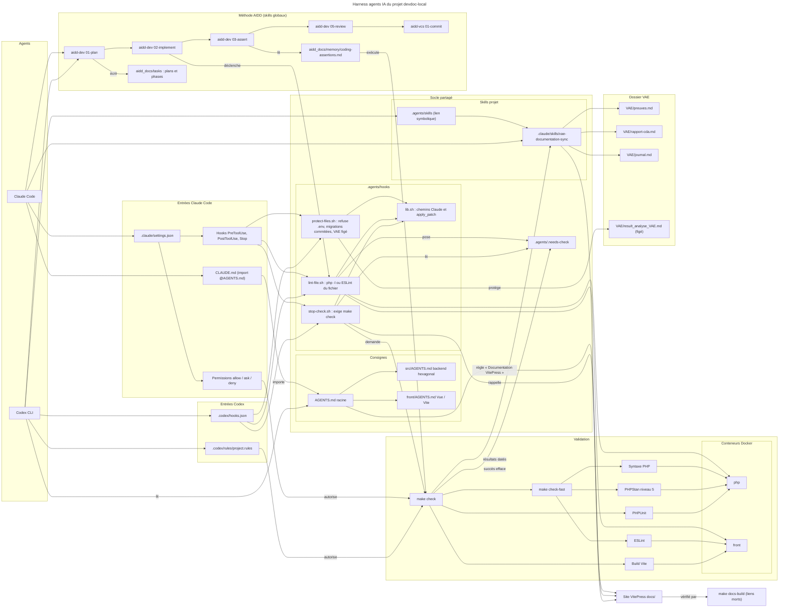

# Harness agents IA — Claude Code, Codex et AIDD

Architecture du harness du projet : ce que chaque agent charge, le socle partagé,
la boucle de validation, la méthode AIDD et le dossier VAE.

## Documentation à jour après chaque changement validé

`AGENTS.md` impose à Claude Code et à Codex de reporter dans le site VitePress toute modification validée par `make check` qui change ce que le site décrit (fonctionnalité, API, données, architecture, tests, CI, déploiement), selon une table « changement → page ». Le rappel de fin de tâche (`stop-check.sh`) et le skill `vae-documentation-sync` le redemandent ; `make docs-build` vérifie que le site compile sans lien mort.
