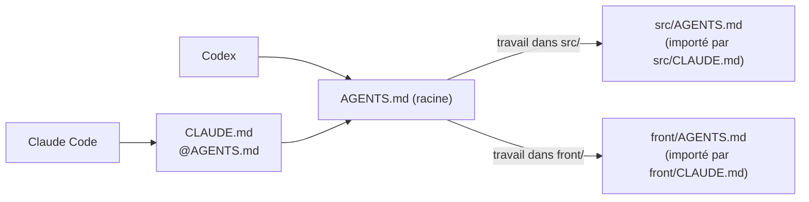

# Consignes

Les règles du projet sont écrites **une seule fois**, dans `AGENTS.md`, au format que lit Codex. Claude Code les charge par un import : [`CLAUDE.md`](../../CLAUDE.md) ne contient qu'une ligne, `@AGENTS.md`.

Les fichiers des sous-dossiers ne sont chargés que lorsque l'agent travaille dans ce dossier : le contexte reste court.

## Contenu

| Fichier | Sections | Exemples de règles |
|---|---|---|
| [`AGENTS.md`](../../AGENTS.md) | Stack, lancement, **validation obligatoire**, conventions, **interdits**, documentation VitePress, règle documentaire VAE | « Une tâche n'est terminée que si `make check` passe » ; ne jamais lire `.env.local` ; pas de `git push` ni de migration sans accord |
| [`src/AGENTS.md`](../../src/AGENTS.md) | Architecture hexagonale, tests, qualité, sécurité | Nouveau code métier en `Domain` / `Application` / `Infrastructure` sur le modèle Note ; tout handler a son test ; ne jamais ajouter d'erreur à la baseline PHPStan |
| [`front/AGENTS.md`](../../front/AGENTS.md) | Stack, organisation, règles, validation | HTML de l'API via `SafeHtml.vue` ; appels HTTP via `src/services/` ; nouveau test pour toute logique ajoutée |
| [`coding-assertions.md`](../../aidd_docs/memory/coding-assertions.md) | Contrôles avant commit et avant push | L'ordre des cibles `make`, les pièges (baseline, CI moins stricte que le local) |

## Principes d'écriture

- **Vérifiable** : chaque règle renvoie à une commande ou à un fichier (`make check`, `phpstan-baseline.neon`), pas à une intention.
- **Court** : seulement ce que l'agent ne peut pas deviner en lisant le code.
- **Doublé par un garde-fou** quand l'enjeu est fort : l'interdit « ne pas lire `.env.local` » est aussi bloqué par les [permissions](permissions.md), et « ne pas modifier une migration commitée » par un [hook](hooks.md).
