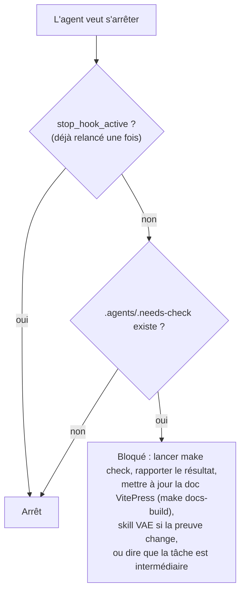

# Hooks

Un hook est un script que l'outil lance automatiquement à un moment précis : avant qu'un agent écrive un fichier, après, ou quand il veut s'arrêter. Les trois scripts sont **communs** à Claude Code et à Codex, dans [`.agents/hooks/`](../../.agents/hooks/lib.sh) ; chaque outil les branche dans son propre fichier.

| Moment | Script | Rôle | Effet |
|---|---|---|---|
| Avant écriture (`PreToolUse`) | `protect-files.sh` | Refuse les fichiers protégés | L'écriture n'a pas lieu ; l'agent reçoit la raison |
| Après écriture (`PostToolUse`) | `lint-file.sh` | Vérifie la syntaxe du fichier, pose le marqueur | Erreur renvoyée à l'agent, qui doit corriger |
| Fin de tâche (`Stop`) | `stop-check.sh` | Exige `make check` si du code a changé | L'agent ne peut pas s'arrêter tout de suite |

Branchement : `Write|Edit|NotebookEdit` pour Claude Code ([`.claude/settings.json`](../../.claude/settings.json)), `apply_patch|Edit|Write` pour Codex ([`.codex/hooks.json`](../../.codex/hooks.json)).

## `lib.sh` : un seul code pour deux outils

Les deux outils n'envoient pas la même chose. Claude Code donne le chemin du fichier (`tool_input.file_path`) ; Codex envoie un patch (`apply_patch`) dont il faut lire les en-têtes `*** Update File: …`. `target_files()` extrait les fichiers visés dans les deux cas, et `project_root()` retrouve la racine du dépôt (`$CLAUDE_PROJECT_DIR`, sinon `git rev-parse`).

## `protect-files.sh`

| Fichier visé | Raison renvoyée à l'agent |
|---|---|
| `.env`, `.env.local`, `.env.prod`, `.env.*.local`, `.env.local.php` | Fichier d'environnement réel : utiliser `.env.local.example` ou demander |
| `VAE/result_analyse_VAE.md` | Analyse VAE historique figée |
| `VAE/evidence/*` | Preuves immuables : un nouveau run crée un nouveau dossier |
| `migrations/*.php` **déjà commitée** | Créer une nouvelle migration avec `doctrine:migrations:diff` |

Une migration pas encore commitée reste modifiable : le script le vérifie avec `git ls-files`.

## `lint-file.sh`

| Fichier modifié | Contrôle immédiat | Marqueur `.needs-check` |
|---|---|---|
| `src/`, `tests/`, `config/`, `migrations/` (`.php`) | `php -l` dans le conteneur `php` | Oui |
| `front/src/` (`.vue`, `.js`, `.ts`) | ESLint (`--quiet`) dans le conteneur `front` | Oui |
| `services/` (micro-service Node) | — | Oui |
| `config/`, `.github/`, `compose*.yaml`, `Dockerfile`, `nginx*.conf`, `vite.config.js`, `package.json`, `composer.json` | — | Oui |
| Documentation, autres fichiers | — | Non |

Si le conteneur n'est pas démarré, le contrôle est sauté mais le marqueur est posé quand même.

## `stop-check.sh`

Le marqueur n'est effacé que par un **`make check` réussi** (dernière ligne de la cible dans le [`Makefile`](../../Makefile)).

## Vérifié

Le 2026-10-13, en envoyant aux scripts les mêmes entrées JSON que les outils :

| Cas | Résultat observé |
|---|---|
| Écrire `.env.local` | `deny` avec la raison « Fichier d'environnement réel » |
| Écrire une migration commitée | `deny` |
| Patch Codex visant `VAE/result_analyse_VAE.md` | `deny` |
| Écrire `src/Kernel.php` | Aucune sortie : autorisé |
| Fichier PHP avec une erreur de syntaxe | `block`, message de `php -l`, marqueur posé |
| Fichier de `services/qcm-results/` | Marqueur posé |
| Arrêt avec marqueur | `block` |
| Arrêt avec `stop_hook_active: true` | Aucune sortie : arrêt autorisé |

## Limites

::: warning
- Le lint ne couvre ni le JavaScript du micro-service Node ni la documentation : seuls `make check` et `make docs-build` les contrôlent.
- Une modification faite **hors des outils d'écriture** (par exemple `sed` ou `python` dans un terminal) ne déclenche aucun hook : ni protection, ni marqueur.
- Les scripts ont besoin de `jq`, `git` et `docker` sur la machine.
:::
