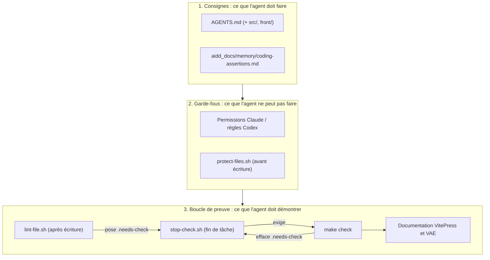
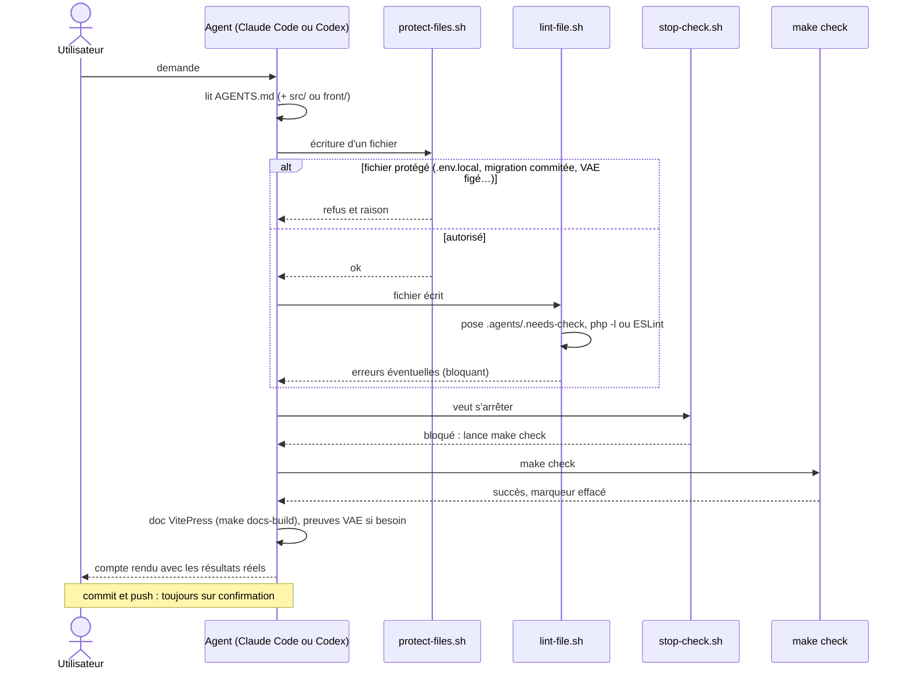

# Harness des agents IA

Le code de DevDoc est en grande partie écrit avec des agents IA : **Claude Code** et **Codex**. Le *harness* est l'ensemble des fichiers qui encadrent ce travail, pour que les deux agents suivent les mêmes règles, ne puissent pas casser ce qui compte et ne déclarent pas une tâche terminée sans preuve.

| Garantie | Comment | Page |
|---|---|---|
| Les deux agents ont les **mêmes consignes** | Un seul fichier `AGENTS.md`, lu par Codex et importé par Claude Code | [Consignes](consignes.md) |
| Ils **ne peuvent pas détruire** la base, lire les secrets ou pousser seuls | Permissions Claude et règles Codex : autorisé, à confirmer, interdit | [Permissions](permissions.md) |
| Ils **ne peuvent pas modifier** les fichiers protégés | Hook avant écriture, commun aux deux agents | [Hooks](hooks.md) |
| Une erreur de syntaxe est **signalée tout de suite** | Hook après écriture : `php -l` ou ESLint dans Docker | [Hooks](hooks.md) |
| Une tâche **n'est pas finie** sans `make check` réussi | Marqueur posé à chaque modification, rappel en fin de tâche | [Validation](validation.md) |
| La **documentation suit** le code | Règle VitePress, skill de synchronisation VAE | [Méthode et documentation](methode.md) |

## Les trois couches

## Une tâche, du début à la fin

## Claude Code et Codex côte à côte

| Pièce | Claude Code | Codex | Partagé |
|---|---|---|---|
| Consignes | `CLAUDE.md` → `@AGENTS.md` | `AGENTS.md` lu directement | `AGENTS.md`, `src/AGENTS.md`, `front/AGENTS.md` |
| Commandes | `.claude/settings.json` (`permissions`) | `.codex/rules/project.rules` | Mêmes décisions |
| Hooks | `.claude/settings.json` (`hooks`) | `.codex/hooks.json` | Scripts `.agents/hooks/` |
| Skills | `.claude/skills/` | `.agents/skills/` (lien symbolique) | `vae-documentation-sync` |

La carte détaillée de toutes les pièces est dans [Carte complète](../harness-agents.md).

## Limites

::: warning
- **Rien n'oblige à mettre la doc à jour** : la règle est rappelée, pas vérifiée. Seul `make docs-build` détecte un lien cassé.
- **Le rappel peut être ignoré** : `stop-check.sh` bloque une seule fois (il laisse passer si l'agent s'est déjà arrêté une fois après le rappel), et un agent peut répondre que la tâche est volontairement intermédiaire.
- Les hooks de lint ne vérifient pas les fichiers du micro-service Node ni la documentation : seul `make check` (ou `make docs-build`) les contrôle.
- Le harness protège le dépôt local ; la CI reste le contrôle indépendant, et PHPStan y est encore informatif.
:::
