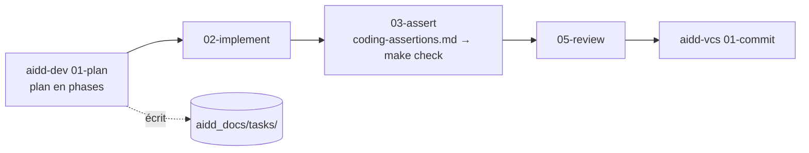

# Méthode et documentation

## AIDD : planifier avant de coder

AIDD est un ensemble de skills installés au niveau de l'utilisateur (plugins Claude Code `aidd-*`, hors du dépôt). Pour une tâche importante, l'agent suit un cycle explicite :

Les plans écrits ainsi sont versionnés dans [`aidd_docs/tasks/`](../../aidd_docs/tasks/README.md) (5 documents, du 2026-08-31 au 2026-09-07), avec leur statut réel d'après les PR. Depuis le 2026-10-12, les tâches sont suivies dans les PR et la [gestion de projet](../gestion-de-projet.md).

## Documentation : deux règles

| Règle | Où | Ce qu'elle demande | Vérification |
|---|---|---|---|
| **Documentation VitePress** | [`AGENTS.md`](../../AGENTS.md), section « Documentation VitePress » | Après un changement validé, mettre à jour la page concernée (table « changement → page ») ; un refactoring sans effet visible est signalé comme tel | `make docs-build` |
| **Preuves VAE** | Skill [`vae-documentation-sync`](../../.claude/skills/vae-documentation-sync/SKILL.md) | Mettre à jour `VAE/preuves.md` et `VAE/journal.md` avec des preuves réelles : fichier, test, run CI, déploiement | Relecture ; aucune affirmation sans preuve |

Les deux sont rappelées par `stop-check.sh` en fin de tâche. Le skill est partagé : Codex le lit par le lien symbolique `.agents/skills/vae-documentation-sync`.

## Niveaux de preuve

Les deux documentations utilisent la même échelle, affichée ici par un badge :

| Badge | Signifie |
|---|---|
| <Status is="code" /> | Le fichier existe ; rien n'a été exécuté |
| <Status is="local" /> | Une commande ou un test a été lancé en local, résultat conservé |
| <Status is="ci" /> | Un run GitHub Actions identifiable a réussi |
| <Status is="prod" /> | Vérifié sur `devdoc.varascundo.com` |
| <Status is="prevu" /> | Décidé, pas encore fait |

Une information ne monte d'un niveau qu'avec la preuve correspondante : une CI verte ne vaut pas un déploiement vérifié.
