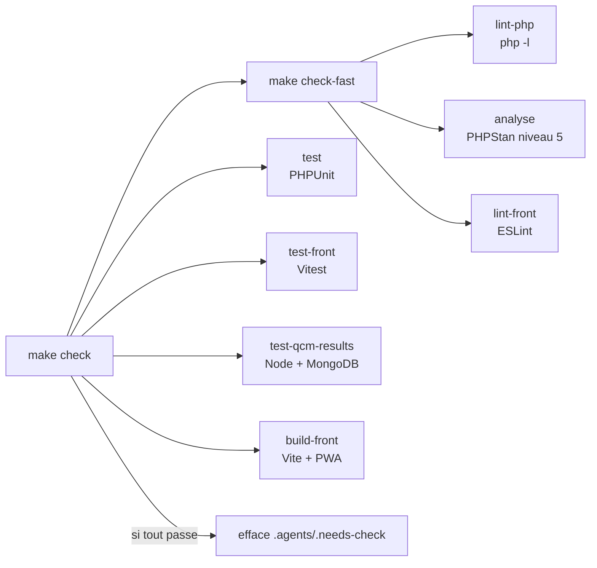

# Validation

Toute la vérification passe par le [`Makefile`](../../Makefile), dans les conteneurs Docker : les agents, l'humain et la documentation utilisent les mêmes commandes.

| Cible | Quand | Contrôle |
|---|---|---|
| `make check-fast` | Pendant l'itération | Syntaxe PHP, PHPStan, ESLint |
| `make check` | **Avant de dire qu'une tâche est finie** | En plus : PHPUnit, Vitest, tests du micro-service, build Vite |
| `make test-e2e` | Après un changement de parcours utilisateur | Playwright sur l'application compilée (`docker compose run --rm front-build` avant) |
| `make docs-build` | Après une modification de `docs/` | Le site VitePress compile, sans lien mort |

## Ce que la CI refait

| Contrôle | Local | CI ([`ci.yml`](../../.github/workflows/ci.yml)) |
|---|---|---|
| Syntaxe PHP, PHPUnit, Vitest, build | Bloquant | Bloquant |
| Tests du micro-service | Bloquant | Bloquant (job ajouté, pas encore exécuté sur GitHub) |
| PHPStan | Bloquant | **Informatif** |
| ESLint | Bloquant | **Absent** |
| Playwright, build de la doc | À la demande | **Absents** |

Le local est donc plus strict que la CI : c'est le harness qui fait respecter PHPStan et ESLint. Détail de la CI : [CI/CD](../CI_CD.md).

## Règles de compte rendu

Écrites dans [`AGENTS.md`](../../AGENTS.md) et [`coding-assertions.md`](../../aidd_docs/memory/coding-assertions.md) :

- un échec n'est jamais masqué : il est rapporté avec sa sortie ;
- une erreur antérieure au changement est nommée, pas ignorée ;
- on n'ajoute jamais d'erreur à `phpstan-baseline.neon` pour faire passer l'analyse.
