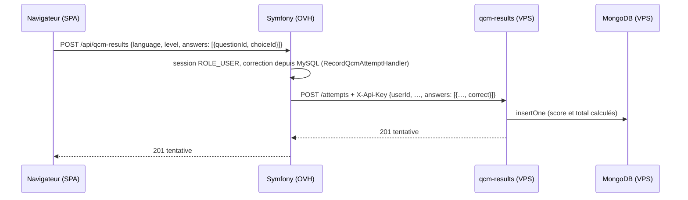

# Micro-service résultats de QCM

API interne en Node 22 (Fastify 5) qui stocke les tentatives de QCM dans MongoDB 7. Seul Symfony l'appelle : il authentifie l'utilisateur, corrige les réponses à partir de MySQL, puis transmet la tentative corrigée avec l'identifiant de l'utilisateur. Le navigateur ne parle jamais à ce service.



## API

Toutes les routes, sauf `/health`, exigent l'en-tête `X-Api-Key` (comparaison à temps constant). Les corps et paramètres sont validés par schéma JSON : un champ inconnu ou mal typé renvoie 400.

| Route | Rôle |
|---|---|
| `GET /health` | Vérifie la connexion MongoDB (sonde Docker/Coolify) |
| `POST /attempts` | Enregistre une tentative ; score et total sont calculés ici |
| `GET /users/:userId/attempts?limit=` | Historique, la plus récente d'abord, sans le détail des réponses |
| `GET /users/:userId/progress` | Agrégation par langage et niveau : tentatives, meilleur, moyen et dernier score |
| `DELETE /users/:userId/attempts` | Efface les tentatives d'un utilisateur |
| `GET /stats/questions?language=&level=&limit=` | Taux de réussite par question, la plus ratée d'abord |

## Données

Une collection `attempts`, un document par tentative :

```json
{
  "userId": 3, "language": "CSS", "level": "basique", "score": 2, "total": 3,
  "answers": [{ "questionId": 12, "choiceId": 48, "correct": true }],
  "createdAt": "2026-10-12T19:45:59.681Z"
}
```

Index créés au démarrage (`ensureIndexes`) : `user_history` `{userId: 1, createdAt: -1}` et `question_stats` `{language: 1, level: 1, "answers.questionId": 1}`.

## Configuration

| Variable | Défaut | Rôle |
|---|---|---|
| `MONGODB_URL` | obligatoire | Chaîne de connexion MongoDB |
| `MONGODB_DB` | `devdoc` | Nom de la base |
| `QCM_RESULTS_API_KEY` | obligatoire, 32 caractères minimum | Clé partagée avec Symfony |
| `PORT` | `3000` | Port d'écoute |

Côté Symfony : `QCM_RESULTS_URL` et `QCM_RESULTS_API_KEY` (client `qcm_results.client` dans `config/packages/framework.yaml`). Sans configuration, l'URL par défaut `http://qcm-results.invalid` ne se résout pas et l'API répond 503 ; le reste du site fonctionne.

## Local

`make up` démarre `qcm-results` et `qcm-mongo` (MongoDB non publié sur l'hôte). Tests sur un vrai MongoDB, base jetable :

```bash
make test-qcm-results
```

Ils font partie de `make check` et du job CI « QCM results service ».

## Déploiement prévu : VPS Netcup avec Coolify

**Pas encore réalisé.** Procédure retenue :

1. Dans Coolify, créer une base **MongoDB 7 dédiée** (séparée du MongoDB des services MCP), sans port public, avec des sauvegardes planifiées.
2. Créer une application depuis ce dépôt : base directory `services/qcm-results`, build par le `Dockerfile` (image `node:22.21.0-alpine`, utilisateur non root, `HEALTHCHECK` sur `/health`), sur le même réseau que la base.
3. Variables : `MONGODB_URL` (fournie par Coolify), `QCM_RESULTS_API_KEY` générée aléatoirement (`openssl rand -hex 32`).
4. Domaine HTTPS (Traefik et Let's Encrypt par Coolify), par exemple `qcm-api.varascundo.com`, avec un enregistrement DNS A vers le VPS.
5. Sur OVH, dans `.env.local` : `QCM_RESULTS_URL=https://<domaine>` et la même clé.
6. Vérifier depuis le contexte web OVH que l'appel sortant en HTTPS passe. Depuis le SSH OVH, les connexions sortantes sont bloquées ; le contexte web n'a pas encore été testé.
